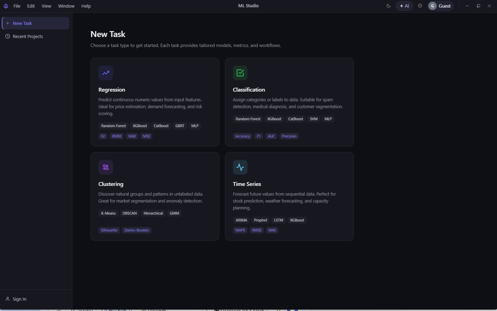

<div align="center">

# ML Studio

**从表格到实验报告，一条链路跑完**

桌面端机器学习工作台 · 本地优先 · 数据不出机器

[官网](https://marvin-lijunzan.github.io/ML-Studio/) · [下载](https://github.com/Marvin-LiJunZan/ML-Studio/releases) · [问题反馈](https://github.com/Marvin-LiJunZan/ML-Studio/issues)

</div>



---

## 这是什么

ML Studio 把数据导入、模型选择、超参数搜索、训练监控和报告导出收进同一个窗口。
拖进一张表格，选一个任务类型，剩下的交给它跑——不用写训练脚本，也不上传数据到别人的服务器。

面向需要反复做实验、又要交付结论的人：模型跑完不是终点，能生成一份带图表的实验报告才算完事。

## 核心能力

| 能力 | 说明 |
|---|---|
| **四类建模任务** | 回归、分类、聚类、时间序列，各自配好 estimator、评估指标与交叉验证策略 |
| **自动超参寻优** | 基于 Optuna 的 TPE / CMA-ES / Random / NSGA-II，可选 Hyperband 提前停止 |
| **训练诊断** | 残差图、学习曲线、过拟合检测、混淆矩阵、ROC/PR、轮廓系数、肘部法则、预测 vs 实际 |
| **报告导出** | HTML / Markdown / Word / PDF 四种格式，图表随报告一起出 |
| **工程文件** | `.ml` 工程保存与打开，模型单条与批量预测 |
| **AI 助手** | 结果看不懂时在侧栏直接问，可接 OpenAI / DeepSeek / 通义千问等兼容接口 |

## 下载

前往 [Releases](https://github.com/Marvin-LiJunZan/ML-Studio/releases) 获取最新版本：

| 平台 | 包 |
|---|---|
| Windows 10 / 11 (x64) | 安装包 `.exe` |
| macOS (Apple Silicon) | `.dmg` / `.zip` |
| Linux (x64) | `.AppImage` / `.deb` |

**关于首次启动**：需要加载本地推理引擎，约 10–30 秒，期间窗口空白属于正常。

**关于 macOS**：安装包未做代码签名，首次打开若被 Gatekeeper 拦下，
在应用上右键 → 打开，或到「系统设置 → 隐私与安全性」里允许一次即可。

## 上手三步

1. **导入数据** —— 拖入 CSV / Excel，自动识别列类型
2. **选任务与目标** —— 选回归/分类/聚类/时间序列，指定目标列与度量
3. **开始训练** —— 超参搜索与训练进度实时可见，结束后直接出报告

## 技术栈

- **后端**：FastAPI + scikit-learn + Optuna，PyInstaller 打成单文件可执行程序
- **前端**：原生 HTML/JS + ECharts，由后端直接托管，无构建步骤
- **桌面壳**：Electron，拉起本地后端并托管窗口
- **数据**：全部落在本机用户目录，无外部数据库、无需 Docker

## 项目结构

```
backend/     FastAPI 应用：训练、预测、报告、诊断、任务类型
static/      前端页面（原生 JS + ECharts），随包内置
electron/    桌面壳与打包配置
website/     产品站（本站）
docs/        设计文档与验收记录
```

## 许可

MIT
